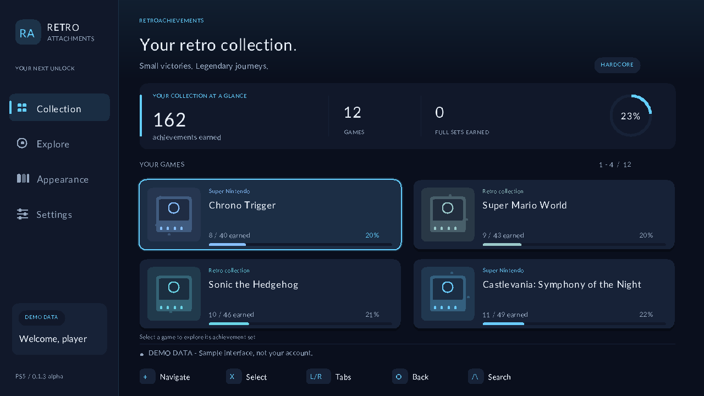
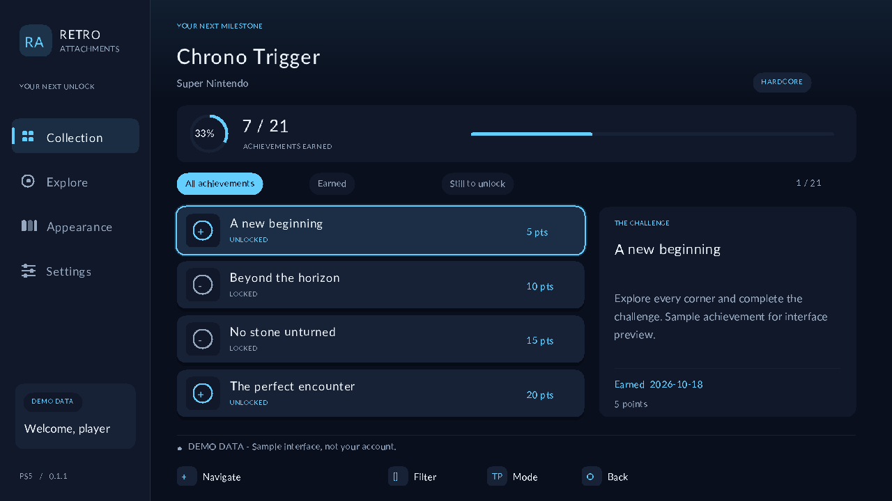
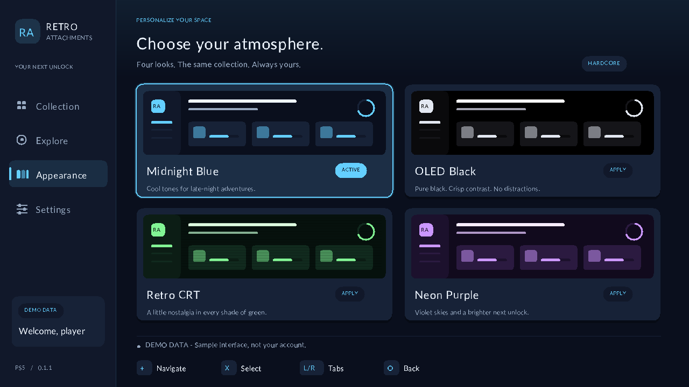

# Retro Attachments — PS5 RetroAchievements viewer

**v0.1.3-alpha.1** packages the viewer and graphical installer for **PS5 Homebrew Launcher / websrv**. Earlier alpha builds failed to allocate display memory when launched through Payload Manager. This build corrects the launch path; successful display on firmware 13.60 still needs confirmation.

## Download and run

[Download v0.1.3-alpha.1](https://github.com/luvwrld999/retro-attachments/releases/tag/v0.1.3-alpha.1). Start with **Retro-Attachments-Homebrew-Launcher.zip**.

1. Extract the ZIP's `homebrew` folder to the root of a USB drive, or copy its two app folders into `/data/homebrew/` using FTP.
2. Close any running game/homebrew, start your jailbreak and Homebrew Launcher / websrv, and open its homebrew library (usually `http://YOUR-PS5-IP:8080/`).
3. Launch **RetroAttachments** from that library. Use its graphical homebrew launch action, not Payload Manager or websrv's ELF-upload/daemon action.
4. If the viewer opens, test the demo and then enter your RetroAchievements username and web API key in **Settings**. The key is available at https://retroachievements.org/settings; do not enter your password.
5. Optionally launch **RetroAttachmentsInstaller** from the same library to install the ShadowMountPlus home-screen shortcut.

See [installation and recovery](docs/INSTALL.md). The installed shortcut now requests graphical homebrew launch through websrv on **127.0.0.1:8080**. Keep websrv running when using it. ShadowMountPlus alone does not replace websrv.

## Why the launch path changed

The on-console diagnostic reached SDL's window-surface creation and reported `sceKernelAllocateMainDirectMemory: Resource temporarily unavailable`. The linked PS5 SDL backend requests 64 MiB of direct display memory there. Ordinary ELF loading and graphical homebrew loading are separate paths in upstream websrv; the latter starts the ELF in a BigApp process. The old shortcut incorrectly streamed the viewer to the ordinary ELF loader on port 9021.

This version uses the graphical path and keeps startup notifications and `/data/retro-attachments-startup.log` enabled. It does not alter console memory budgets or apply kernel patches. Desktop tests and compilation do not establish on-console compatibility.

## Interface preview

Demo data shown below; no account credentials are included.







## Account settings

Settings stay in `/data/retroatlas/settings.json` for update compatibility. The API key is masked in the interface and stored as plaintext with restrictive file permissions. Do not share this file. Desktop builds use `userdata/`. The embedded CA certificate bundle is written to the data directory; TLS verification stays enabled. Ensure the console clock is correct and storage is writable.

## Controls

| Action | DualSense | Desktop keyboard |
| --- | --- | --- |
| Navigate | D-pad / left stick | Arrow keys |
| Select / open | Cross | Enter |
| Back / focus sidebar | Circle | Escape |
| Previous / next tab | L1 / R1 | Shift+Tab / Tab |
| Search game titles | Triangle | S |
| All / earned / locked achievements | Square | F |
| Hardcore / Softcore (any unlock) | Touchpad click* | H |
| Refresh library / current game | Options | R |
| Exit | Settings → Exit Retro Attachments | F10 |

*Uses SDL's Back button mapping; verify this mapping on your loader/controller combination. Settings also offers a progress-mode toggle.

The on-screen keyboard supports controller entry. Select SAVE to apply or Circle to cancel. A USB keyboard can also enter text; Enter saves. Game search applies to the currently loaded collection or console catalogue.

## Included

- Paginated loading of the user's complete game-completion list.
- Console catalogue browser, cached on disk for 24 hours to reduce API traffic.
- Per-game achievement badges, descriptions, points and earned dates.
- Separate Hardcore and Softcore/any-unlock filtering. A Hardcore unlock counts as earned in the any-unlock view.
- Asynchronous HTTP and image requests, TLS verification, bounded downloads and a bounded texture cache.
- Four persistent themes, keyboard/controller account entry and distinct demo mode.
- Desktop test build and regression tests for parsing, state transitions and saved settings.

This is a viewer. It does not award achievements or integrate with an emulator. Current limitations: no full offline profile cache, no profile leaderboard/points dashboard, no automatic refresh, no global cross-console search, no PKG wrapper. Long text is clipped to the available panel space. The embedded font renderer covers basic Latin and Latin-1; other characters use placeholders. The CRT theme is a color palette, not a CRT shader. Console display/input behavior and authenticated live API responses remain to be verified on real hardware.

## Build

The build used the ps5-payload-dev package **v0.41.1**, LLVM **18**, and the supplied PS5 SDL **2.30.12** port. Source SDK and package recipes:

- https://github.com/ps5-payload-dev/sdk
- https://github.com/ps5-payload-dev/pacbrew-repo/releases/tag/v0.41.1
- https://github.com/ps5-payload-dev/SDL/tree/release-2.30.x-ps5

Download `ps5-payload-dev.tar.gz` from that release and extract it into `.toolchain/` (preserving `opt/ps5-payload-sdk`). Alternatively set `PS5_PAYLOAD_SDK` to an existing installation. Python 3 creates the embedded asset header. LLVM needs clang, lld and llvm-config.

```sh
# macOS with Homebrew LLVM 18
export LLVM_CONFIG=/opt/homebrew/opt/llvm@18/bin/llvm-config
make ps5
make installer
make test-installer test-surface test-bundle
python3 scripts/package_release.py

# Desktop requires SDL2 and libcurl development files plus their *-config tools.
make desktop
./build/retro-attachments --demo
make test
```

`make test` uses SDL's dummy video driver; no display or API key is required. The tests cover fixture parsing and UI behavior, not PS5 hardware or live API availability.

```sh
# Render a preview without opening a desktop window
SDL_VIDEODRIVER=dummy ./build/retro-attachments --demo --screenshot build/library.bmp
SDL_VIDEODRIVER=dummy ./build/retro-attachments --demo --detail --screenshot build/detail.bmp
SDL_VIDEODRIVER=dummy ./build/retro-attachments --demo --themes --screenshot build/themes.bmp
```

API reference: https://api-docs.retroachievements.org/ . The app uses GetUserCompletionProgress, GetConsoleIDs, GetGameList and GetGameInfoAndUserProgress. API keys are URL-encoded and never printed in application logs. API requests are serialized; the worker pauses between requests. HTTP 429 errors require waiting before manual retry.

## Hardware acceptance checklist

- ELF loads and opens a readable display; returns cleanly through Settings → Exit.
- DualSense directions, Cross/Circle and shoulders work; reconnect works.
- Settings persist under `/data/retroatlas/` across restarts.
- Account connection returns real games; compare a known game and unlock date with the website.
- Hardcore and any-unlock counts match the account's data.
- Explore a console and a game not in the account library; check badge downloads.
- Disconnect networking, refresh, and confirm an actionable error with a responsive UI.

The former RetroAtlas internal title ID, ownership marker, bundled payload filename, and `/data/retroatlas` settings path remain unchanged for update compatibility. The visible name is Retro Attachments.

## Development status

This repository includes a GitHub Actions build workflow, contributor notes, a hardware-test report template and a source-archive script. Automated builds produce hardware-test artifacts. A passing build does not establish PS5 compatibility; on-console testing is still required.

## License

Application source: GPL-3.0-or-later. See `LICENSE` and `THIRD_PARTY.md`. Retro Attachments is an independent project and is not affiliated with Sony or RetroAchievements. Game art and achievement badges are fetched from RetroAchievements and are not bundled with the app.

## Interface polish in 0.1.1

The collection now uses four larger cards per page, an earned-achievement overview, clearer controller focus, progress rings and distinct theme previews. Artwork placeholders are original geometric cartridge designs; real game icons and badges still load from RetroAchievements. Summary figures describe the loaded collection or console, not global profile statistics.
